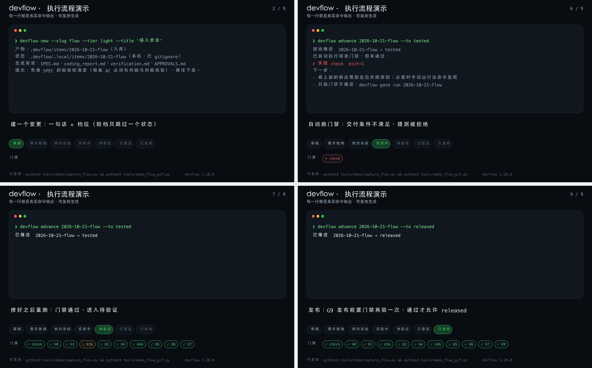

# devflow-kit

<sub>中文 · <a href="README.en.md">English</a></sub>

> **通用研发工作流**：从需求、拆解、契约、实现、测试、验证到发布。
> 与项目无关、**零依赖**（只用 Node 内置模块）、**数据与界面解耦**。
> 强制力来自**产物契约 + 状态机 + 可执行门禁**，不来自文档。

> **第一次用？直接看 [`docs/00-quickstart.md`](docs/00-quickstart.md)** —— 三条命令装好、从提需求到发版的操作指南。
> 需要契约判定、看板插件、多仓工作区等增强时，看 [`docs/08-advanced.md`](docs/08-advanced.md)。

## 看它怎么跑（约 7 秒）

[](docs/demo-flow.gif)

<sub>**首屏是静图**（四格故事板，最清晰）；**点图看完整动图**（1250×775，约 3MB）。</sub>

一个变更从建立到发布：**草稿 → 需求就绪 → 实现中**（提测时门禁不满足，**被拒**）**→ 待验证 → 已验证 → 已发布**。
底部状态轨会逐节点亮起；发布前 **G9** 再验一次。轻档只跳过「契约冻结」一个状态——轨道上不会点亮的不是没跑，是**按档位跳过**。
图里每一行都是真实命令输出，不是手写台词 —— 可复跑生成：

```bash
python3 tools/demo/capture_flow.py --out docs/demo-flow.json   # 真跑一遍并采集
python3 tools/make_flow_gif.py --data docs/demo-flow.json --out docs/demo-flow.gif
```

<sub>末帧静图：[docs/demo-flow.png](docs/demo-flow.png)。动图 2 倍超采样后缩回，文字边缘不糊；GIF 里每行是真实输出的**截断**（长行以 … 结尾），完整原文见 [docs/demo-flow.json](docs/demo-flow.json)。
生成图需要 Pillow —— **只用于演示渲染**，devflow 本体仍是零依赖。</sub>

## 先拿到它

```bash
git clone https://github.com/darkknight110/devflow-kit.git ~/.devflow-kit
```

> **不走 npm**：`devflow-kit` 这个 npm 包名**属于另一个不相关的项目**（[dean0x/devflow](https://github.com/dean0x/devflow)）。
> `npm install -g devflow-kit` / `npx devflow-kit` 能装成功，但装到的不是本工具 —— 所以本工具只通过 git clone 分发。
> 装完用 `~/.devflow-kit/bin/devflow`（若想直接敲 `devflow`，自己加个别名或软链）。

> **零依赖**：只用 Node 内置模块（Node ≥18），不需要 `npm install` 装依赖、不需要构建。

## 装到你的项目（一条命令）

```bash
cd <你的项目>
~/.devflow-kit/bin/devflow setup      # 装本地提交钩子 + 装 DSH 聊天技能
```

## 十分钟上手（技术栈按 pom.xml/package.json/pyproject.toml/go.mod 自动识别）

```bash
./bin/devflow init --name my-project --stack java-maven   # 不写 --stack 也能自动识别
./bin/devflow doctor                          # ★ 先体检：门禁健康 + 基础标准达成，一处看清
./bin/devflow standards                       # 逐条判定产品基础标准（含如何自定义/覆盖）
./bin/devflow clarify <变更>                    # 需求澄清：6 条通用必答项（未决项不许进实现）
./bin/devflow task <变更> T-2 --status 进行中    # 任务级干预（阻塞须给原因）
./bin/devflow view                            # 生成可点击的单文件 HTML 视图
./bin/devflow setup-hooks                     # 安装提交信息钩子（每台新机器都要跑一次）
./bin/devflow ci --platform gitlab --item <变更>  # 生成 CI 配置：把门禁变成结构强制
./bin/devflow new --slug first --tier light --title "第一个变更"
./bin/devflow gate run <item> --to verified   # 跑门禁并做内容层校验（不加 --to 只按当前状态判）
./bin/devflow advance <item> --to verified    # 推进（按目标状态校验，缺件即拒绝）
./bin/devflow report                          # 生成只读看板
```

发布前置门禁（可选，opt-in）：

```json
{
  "release": { "requires": ["test", "data"] },
  "gates": { "test": { "run": "./scripts/test.sh" }, "data": { "run": "./scripts/data-gate.sh" } }
}
```

声明后，`advance --to released` 会**先现跑一遍门禁**；任一声明门禁没有 pass 记录（失败、未验证、豁免都算）就拒绝发布。

**新项目一条命令接好**（需要先装 [deliverable-check](https://github.com/darkknight110/deliverable-check)）：

```bash
devflow init --with-preflight
```

它会生成 `scripts/preflight-gate.sh` 与 `preflight-should-fail.sh`（负向对照现场造一张脏表），
把 `preflight` 门禁写进 `devflow.json` 并加入 `release.requires`——**数据没体检过，就发不出去**。
判据与反例见 [`docs/09-gates-reference.md`](docs/09-gates-reference.md#g9-发布前置门禁阻断)。

**逐命令帮助**：`devflow help <命令>` 或 `devflow <命令> --help`。
**纯计划模式**：`devflow new --plan` 只打印将要生成的文件，不写任何东西。

---

## 它解决什么

| 痛点 | 本工具的应对 |
|---|---|
| 规则有、入口无 | G0 校验项目配置；引用缺失即阻断 |
| 门禁有、跑不通 | 门禁是项目自己声明的命令，引擎只调用与留痕 |
| 新用户被「假通过」骗 | `doctor` 体检（本仓没测试、门禁恒真、正则抓不到计数都会点名）+ 未配置时保留占位脚本：门禁没配好时绝不显示「可以开工」 |
| 判据不可核 | 每条结果必含命令原文 + 退出码 + 输出尾部（G2） |
| 恒真门禁静默放行 | 负向对照未声明或恒真 ⇒ **未验证通过（⚠）**，绝不给 ✓（G3） |
| 静默降档 | 轻档却动契约/接口 ⇒ ⚠ 需人工确认（G7，启发式，明示会漏报） |
| 发布时拿旧记录当证据 | `release.requires` 声明的门禁必须在 released 前现跑并各有一条 pass 记录（G9，⚠ 不算通过） |
| 存量项目测试为零 | 基线豁免：显式登记、显示为警告、**只减不增**（G6） |
| 上下文被压垮 | 变更体积与指令链体积受检（G4 / G4b），不依赖分词器 |
| 进度看不见 | 阶段/任务声明 + `status --digest` 固定摘要 + 只读 HTML 看板 |
| 缺产物时不知道该填什么 | `advance --check` 预演点名缺哪个文件；`fill` 按模板补齐（绝不覆盖） |
| 中间状态被"假阻断" | 确认点随档位与状态推进（verified 才收口）；提测时自动跑门禁 |
| 每个技术栈的测试输出都不一样 | 内置四个适配器（Maven/Jest/pytest/go），模板里带各自正确的 `count_regex`；`init` 自动识别；Maven 优先用仓库自带 `mvnw` |
| 多模块/多测试类计数被算小 | 计数**累加所有匹配行**（真实试点里曾把 15 个测试记成 4 个） |

---

## 目录

```
devflow-kit/
├── VERSION  LICENSE
├── bin/devflow                 入口（转发到 scripts/cli.mjs）
├── docs/
│   ├── 00-quickstart.md        ★ 操作指南（从零到跑完一次变更，实测可用）
│   ├── 01-workflow-spec.md     工作流正典（阶段/状态/门禁/角色/验收）
│   ├── 02-adoption-guide.md    接入指南（十分钟路径 / 存量项目 / 排障）
│   ├── 03-daily-workflow.md    ★ 日常操作手册（一圈怎么跑、卡住怎么办）
│   ├── 04-standards.md         ★ 基础标准与自定义规则（要求是什么、怎么改）
│   ├── 05-storage.md           ★ 产物存放规则（放哪、是否入库、活多久）
│   ├── 06-pilot-report.md      ★ 真实试点报告（含效率与质量实测）
│   ├── 07-ci.md                ★ 接入 CI：让门禁成为结构强制
│   └── 08-advanced.md          ★ 进阶用法（契约判定 / 看板与插件 / 多仓 / 事件流 / 命令表）
├── templates/                  产物模板（单一事实源，CLI 从这里渲染）
│   ├── GOAL.md SPEC.md CONTRACT.md TASKS.md
│   ├── coding_report.md verification.md APPROVALS.md release-report.md
│   └── roles/                  角色契约：orchestrator / implementer / verifier
├── spec/                       机器可读正典 —— 引擎唯一事实源
│   ├── adapters.json           四个技术栈的脚本模板、count_regex、demo 变体
│   ├── states.json             状态、档位、profile、转移与回退
│   ├── artifacts.json          产物 schema 与必填结构
│   ├── gates.json              门禁定义、判定符号、证据形态、自检用例
│   └── roles.json              角色权限矩阵与确认点
├── scripts/
│   ├── cli.mjs                 命令行装配层
│   ├── selfcheck.mjs           门禁体系自检（72 条用例）
│   └── lib/{manifest,checks,evidence,gate,state,doctor,template,adapter,skill-sync}.mjs
└── examples/
    ├── single-repo-service/        可运行样例工程（Node 形态）
    ├── verify-example.sh           端到端验收：draft → released + 新人零误判 + 确定性
    ├── verify-java-project.sh      第二形态验收：Java/Maven 工程 + 四档路径 + 契约可选性
    ├── verify-stacks.sh            四栈交叉验收：java-maven / node-jest / python-pytest / go-test
    └── verify-independent.sh       独立视角验收：文档卫生 + 只按文档走通一条变更
```

接入方（任意项目）只需要两样：`devflow.json` 与 `.devflow/`。

---

## 门禁判定符号

| 符号 | 判定 | 含义 |
|---|---|---|
| ✓ | pass | 通过，**必须有证据** |
| ⚠ | unverified | **未验证通过**：负向对照缺失/恒真、或启发式提示。**不得显示为 ✓** |
| ■ | exempt | 基线豁免（存量债务），只减不增 |
| ⛔ / ✗ | blocked / fail | **阻断**，不允许推进 |
| ○ | pending | 未运行 |
| ⏸ | stale | 确认点超时 |

---

## 验证（交付前必须全绿）

```bash
npm test                              # 单元测试（纯函数层，43 例，node:test，零依赖）
bash examples/verify-all.sh           # ★ 一次跑完全部验收（自检 + 六套端到端），交付前跑这个
node scripts/selfcheck.mjs            # 门禁体系自检：72/72
bash examples/verify-example.sh       # 端到端（Node 形态，33 条断言）
bash examples/verify-java-project.sh  # 端到端（Java/Maven 形态，25 条断言）
bash examples/verify-stacks.sh        # 四栈交叉验收
bash examples/verify-human-loop.sh    # 人的闭环：干净目录里逐句说人话跑通全链路
bash examples/verify-tiers.sh         # 四档位差异都被正确执行
bash examples/verify-independent.sh   # 独立视角验收：只按文档走一遍（文档卫生 + 陌生人路径）
```

> 上表里的断言数只是量级参考；**是否全绿以 `verify-all.sh` 的退出码为准**（数字会随用例增加而变化）。

`selfcheck` 会构造"恒真门禁""未定义状态""假测试通过""占位门禁"等**故意坏的输入**，断言引擎与 doctor 能正确拦下 —— 门禁自己也要被验证。
（这些坏输入只存在于系统临时目录，跑完即清理。）

---

## 设计约束（改代码前先读）

1. **零依赖**：不得引入任何第三方包；Node 内置模块之外的能力一律不做；
2. **正典在 JSON 里**：判定规则尽量写在 `spec/*.json`，不散落在代码中；
3. **数据与呈现解耦**：状态只存在于 `.devflow/`；终端、看板、聚合都是它的视图，**不得成为第二事实源**；
4. **按目标状态判定**：推进时校验的是目标状态所需产物，不是当前状态（否则门禁形同虚设）；
5. **未知状态必须报错**：不得返回空需求、不得默认放行；
6. **只增不改**：生成器只写显式指定的新目录，**绝不覆盖已存在文件**，**永不改写已有仓库**。

---

## 已知局限

见 `docs/01-workflow-spec.md` 第十一章，共 7 条（单人无法强制确认点、G7 启发式会漏报、未提供负向对照只能标 ⚠、预算用字符估算、看板只读、静态页无法选工作区、文档漂移风险）。

---

## 相关项目

**[deliverable-check](https://github.com/darkknight110/deliverable-check)** —— 交付前体检：数据表能不能发、方案有多少骨架、稿子改了几轮。
其中 `audit_data.py` 已按本仓库的门禁协议接入（`run` + `negative_control`），
示例与验收脚本见 [examples/devflow-gate](https://github.com/darkknight110/deliverable-check/tree/main/examples/devflow-gate)。

**[md-to-office](https://github.com/darkknight110/md-to-office)** —— Markdown → 排版规范的中文 Word(.docx)/PDF。

同一位维护者维护，与 devflow 的「产出交付物」环节配套：devflow 把需求推到发布，最终的方案／报告／验收记录
往往要交给不装工具的人看，Word/PDF 是那个场合的通用格式。它解决一个具体痛点——Markdown 里用
ASCII 字符画（`┌─┐│└┘`）画的架构图，转成 Word/PDF 后必然错位（比例字体 + 中文占 2 格），
所以它按 `md2office.spec.json` 生成真正的分层框图**自动替换**稿内字符画。

- 仓库：https://github.com/darkknight110/md-to-office
- 许可：MIT
- 只出 Word 时零外部依赖（仅 `python-docx` + `Pillow`）

---

## 门禁判据（可单独引用）

每条门禁在防哪一种"看起来通过"、通过条件、留下什么证据、真实踩过什么坑：
**[`docs/09-gates-reference.md`](docs/09-gates-reference.md)** —— 含 12 条反例（恒真门禁、空转的负向对照、管道退出码、只取第一行计数……）。

想把这套判据搬进自己的项目：读 `spec/gates.json`（机器正典），或把该文档第四节整段贴进 `CONTRIBUTING.md`。

---

## 许可

MIT。
